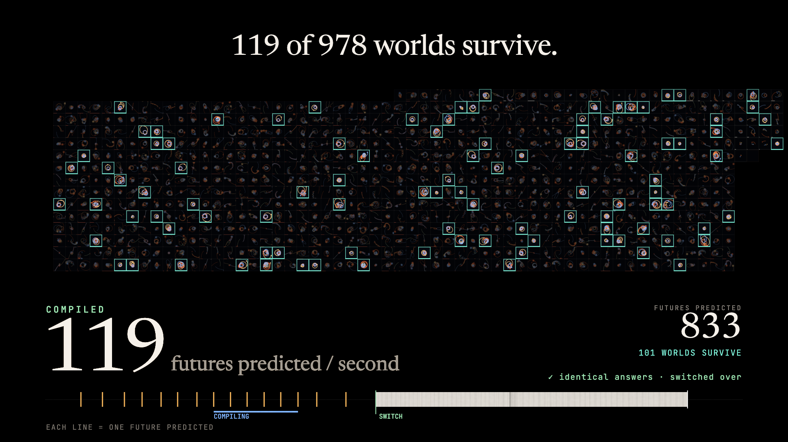

# tierup

Code that an AI agent writes usually runs in an interpreter (QuickJS or similar, inside a sandbox), because that is safe and starts instantly. It is also 10–100× slower than compiled code. `tierup` starts the agent's code in QuickJS right away, compiles the same source to wasm with [scriptc](https://github.com/vercel-labs/scriptc) in the background, checks that both versions return the same output, and switches over mid-run.

[](futures/video/futures.mp4)

The video ([futures/video/futures.mp4](futures/video/futures.mp4), no sound) replays a real run. Each box is one call to the same function: simulate one random arrangement of three suns and a planet for a year and report whether the planet survives.

| `futures/future.ts`, one future per call | ms per call | futures per second |
|---|---:|---:|
| QuickJS (quickjs-emscripten 0.31) | 420.9 | 2.4 |
| scriptc 0.4.10 → wasm, in Node's WebAssembly, no WASI access | 8.2 | 122 |

That is **51× faster**, measured on the same 24 futures on both tiers. In the recorded run the interpreter predicted 15 futures in the first 7.2 s; after the switch the compiled version predicted 964 in the next 8 s. All 964 were recomputed in the interpreter afterwards and matched byte for byte.

## What tiered compilation is

A program can be run in two ways. An **interpreter** reads the code and carries it out step by step, working out what each line means every time it gets there. A **compiler** translates the whole program into machine instructions once, and after that the machine runs those directly. Interpreting starts immediately and runs slowly. Compiling costs time up front and then runs fast.

Tiered compilation is doing both: start in the cheap, slow tier so there is no wait, and move the code that turns out to matter into a faster tier while the program keeps running. Almost every fast language runtime works this way:

- **V8** (Chrome, Node) runs JavaScript in the Ignition interpreter first, then moves hot functions through Sparkplug and Maglev up to the TurboFan optimizing compiler. For WebAssembly it uses Liftoff first and TurboFan later.
- **The JVM** (HotSpot) interprets bytecode, then compiles hot methods with C1 and later C2. It is where the name "tiered compilation" comes from.
- **.NET** compiles each method quickly at tier 0 and recompiles the ones that are called often at tier 1.

Those runtimes can do this because they own the whole engine. An agent sandbox usually does not: it embeds a small interpreter and stops there. `tierup` gets the same effect from the outside, with two off-the-shelf parts:

| | A JIT such as V8 | `tierup` |
|---|---|---|
| Slow tier | bytecode interpreter | QuickJS |
| Fast tier | machine code, generated in-process | wasm, built ahead of time by scriptc in a child process |
| Switch point | can be mid-function (on-stack replacement) | between calls to `run()` |
| When the fast tier is wrong | deoptimizes back to the interpreter | never switches: both tiers must agree on a real input first |
| Speculates on types | yes | no; the source is typed TypeScript |

The trade is simple. A JIT is finer-grained and needs no cooperation from the code. `tierup` needs the work to be a function that is called many times, and it needs code the ahead-of-time compiler accepts. In return it works with any embedded interpreter, the fast tier is still sandboxed wasm, and a wrong compile cannot take over, because the switch only happens after both tiers give identical output.

## How it works

1. The code is one TypeScript file exporting `run(input: string): string`. In `tierup.mjs` a model writes it from `task.md`, which adds a few constraints so an ahead-of-time compiler accepts it (declared interfaces, no `any`, no classes).
2. The code starts immediately in a QuickJS context that has nothing but the script.
3. `scriptc build --lib` compiles the same file to a wasm32-wasi reactor. If scriptc rejects it, the errors go back to the model once; if it still fails, the run stays interpreted.
4. The reactor is loaded in Node's WebAssembly with WASI stubbed deny-by-default (`spike/wasi.mjs`): no files, no environment, no network, only a clock and randomness.
5. The next call runs on both tiers. Only identical output switches the tier.

## Run it

```sh
npm install --ignore-scripts && npm rebuild scriptc
# scriptc's wasm runtime pack: npm i @scriptc/runtime-wasm32-wasi@0.4.10 somewhere and point SCRIPTC_RUNTIME_PACK at it
#   (the futures bench looks for it in ~/code/policy-spike/wasm/node_modules; edit the path in bench.mjs)

node --no-warnings futures/bench.mjs    # the three-sun run: 15 s, then re-checks every compiled answer (several minutes)
node futures/video/make-data.mjs        # turn the recording into the data the video replays
node futures/video/render.mjs futures.html --size 1920x1080   # needs Chrome and ffmpeg

node tierup.mjs                         # the original flow: a model writes run() from task.md, then the run starts
node tierup.mjs --cached                # reuse the last model-written run()
node verify.mjs                         # every batch on both tiers, outputs must match
```

`tierup.mjs` needs an API key: `ANTHROPIC_API_KEY`, `ANTHROPIC_API_KEY_FILE`, or the macOS Keychain item `bee-anthropic`. The futures bench needs none.

## The first workload

The original run has a model write a bank-reconciliation function (400×400 fuzzy matching per call):


| Same model-written `run()` | ms per call |
|---|---:|
| QuickJS | 98.2 |
| scriptc → wasm | 4.5 |
| Node 24 V8 JIT, unsandboxed, for reference | 3.6 |

End to end, 240 batches: **20.8 s interpreted only → 1.6 s with tier-up**, output identical on all 240.

## Limits

- **It only pays off when the code runs long enough or often enough.** Compiling took 0.7–1.9 s here with scriptc's caches warm; a cold first build took about 4.7 s. A one-shot script that runs for 50 ms should stay interpreted.
- **The two tiers do not agree on all floating-point maths.** `Math.pow`, `Math.sin` and `Math.cos` differed in the last bit between QuickJS and the scriptc wasm, which changed 2 pixels per frame in an earlier fractal demo (`mandel/`). `+ - * /` and `Math.sqrt` matched everywhere I tested, and the demos stick to those. Code that needs bit-identical transcendentals across tiers will fail the check and stay interpreted.
- **The check before switching compares one call.** A difference on some other input would be missed at switch time. The benches recompute every compiled answer afterwards to cover this; a production version would keep sampling.
- **scriptc compiles a subset of TypeScript.** The task prompt steers the model into it; other code may need a fix-up round.
- **Who wrote the demo code:** in `tierup.mjs` a model writes `run()` from the task. `futures/future.ts` and the `threebody/` and `mandel/` variants were written by Claude in a coding session and tuned by hand for the video (number of sub-steps, survival rules).
- **One machine** (Apple M4 Pro), CPU-heavy loops only. That is the best case for compilation; scripts that mostly wait on tool calls gain little.

## What's in here

| Path | What |
|---|---|
| `tierup.mjs`, `task.md`, `verify.mjs` | the original model-writes-it flow and its checker |
| `spike/wasi.mjs` | loads a scriptc wasm reactor with WASI denied by default |
| `futures/` | the three-sun prediction run, its recording (`run.json`) and the video source |
| `threebody/`, `mandel/` | earlier demo workloads: 4,500 parallel three-body universes, and a fractal zoom |
